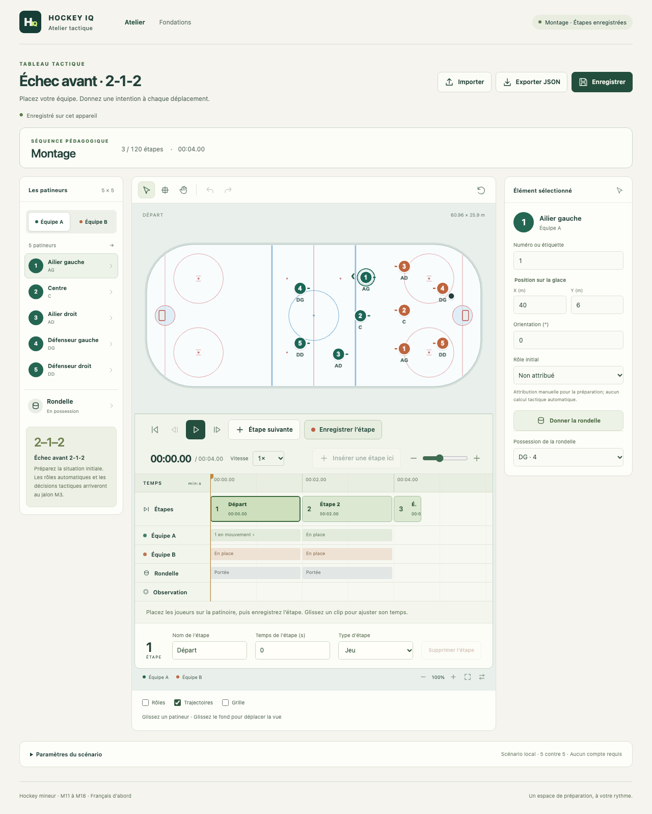
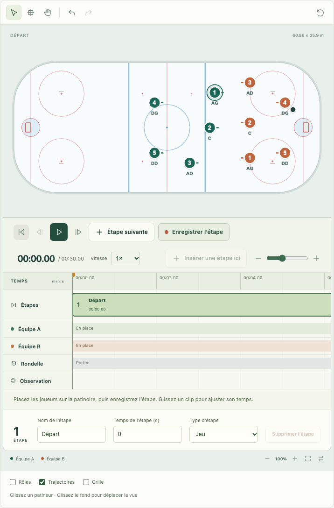
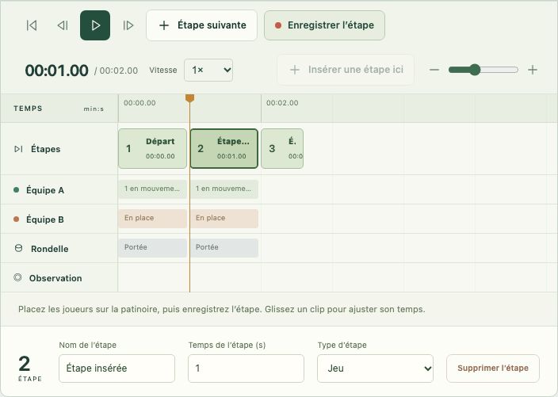

# Éditeur de timeline — bilan

Date : 2026-11-20. Demande : ajouter un montage comparable aux éditeurs de films et concrétiser le parcours d’étapes pédagogiques.

## Utilisation

Sans séquence, seul le bouton **Créer une séquence** est affiché à gauche au-dessus de la patinoire, sans grande carte d’en-tête. Après création ou restauration d’une séquence, il est remplacé par l’en-tête « SÉQUENCE PÉDAGOGIQUE / Montage », au-dessus de l’atelier complet sur toute la largeur de la patinoire au panneau à onglets. La bande de contexte au-dessus de la glace est retirée et sa hauteur ajoutée au viewport : 28 px sur desktop/tablette, 27 px sur mobile. Les dimensions sont dans Patinoire. Les pistes de la timeline restent immédiatement sous le viewport, avec les mêmes bords gauche et droit. Elles défilent dans ce panneau. L’ancien panneau gauche se trouve dans l’onglet Équipes à droite : ce panneau mesure 368 px (+15 %) sur desktop, et la patinoire/timeline utilisent la largeur restante à gauche, après la bande verticale des outils. À 1 000 px et moins, le panneau à onglets passe sous la patinoire/timeline.

1. Préparer la situation sur la patinoire puis cliquer **Créer une séquence** au-dessus de la patinoire. La pose initiale devient le départ; la page cadre l’en-tête Montage complet avec une marge supérieure de 8 px (selon le défilement disponible). « SÉQUENCE PÉDAGOGIQUE », Montage et les compteurs restent visibles; le titre reçoit le focus sans déplacer ce cadrage. Cette navigation suit la création explicite par clic, toucher ou Entrée/Espace.
2. Dans la rangée de navigation sous la patinoire, cliquer l’icône **+ — Insérer une étape**, puis **Ajouter une étape après**, placer chaque joueur et la rondelle à l’endroit souhaité, puis le **point rouge — Enregistrer l’étape** dans la même rangée. Les noms complets restent disponibles en infobulle et pour les lecteurs d’écran. Les commandes occupent une seule ligne : le temps et la vitesse restent à droite; le groupe des actions défile horizontalement si nécessaire, avec accès clavier. Répéter pour construire le jeu.
3. Sélectionner un clip. Dans le panneau de droite, l’onglet **Équipes** permet de choisir l’équipe, un patineur ou la rondelle. Une sélection dans cette liste ouvre **Joueur**, tandis que le choix d’équipe reste dans Équipes. L’onglet **Joueur** contient la pose du joueur courant ou de la rondelle; l’onglet **Étape** contient nom, temps, type, suppression et paramètres d’Observation. L’onglet **Patinoire** contient les dimensions, Rôles, Trajectoires et Grille; ces réglages de vue restent conservés pendant la session lorsque l’on change d’onglet, d’équipe ou d’étape. Le changement d’onglet conserve les positions non enregistrées. Glisser un clip horizontalement ou modifier **Temps de l’étape (s)** dans Étape pour changer sa position dans le temps. Les pistes équipes/rondelle résument les mouvements synchronisés.
4. Utiliser Lecture/Pause et la vitesse à droite. Le bouton **Zoom de la timeline** ouvre un curseur vertical : monter pour agrandir les pistes, descendre pour les réduire. Échap ou un clic extérieur ferme le panneau. **Revenir au début** interrompt la lecture et sélectionne la pose initiale à 00:00.00, sans effacer les étapes ou l’historique; il remet aussi le défilement des pistes au départ. Le curseur de lecture permet de voir les positions entre deux poses; le bouton d’icône **Insérer une étape ici** capture cet instant sans modifier les voisins (son nom est disponible en infobulle).
5. Dans l’onglet **Étape**, choisir **Observation**, le joueur, où regarder et la consigne. La piste dorée et le repère sur la glace montrent la collecte d’information; la lecture s’y arrête jusqu’à reprise.
6. **Enregistrer** conserve tout le montage dans le navigateur; **Exporter JSON** et **Importer** transportent toute la séquence. Les modifications de la pose courante sont incluses dans ces opérations. Annuler/rétablir s’applique au document complet.

Espace dans le montage, hors contrôles interactifs : Lecture/Pause. Un bouton focalisé répond normalement à Entrée/Espace, notamment **Revenir au début**. Les clips sont sélectionnables au clavier; le curseur et le zoom utilisent des sliders natifs. Dans le zoom, Haut/Droite augmentent, Bas/Gauche réduisent, Début/Fin atteignent les bornes; Tab ou Échap ferment le panneau et rendent le focus au bouton. Dans la liste des onglets de l’inspecteur, Gauche/Droite changent d’onglet, Début/Fin sélectionnent le premier/dernier, puis Tab rejoint le contenu actif. Joueur est actif au chargement. Sélectionner un élément depuis Équipes ouvre Joueur et y restitue le focus au bouton d’onglet; une sélection sur la patinoire ou d’une étape ne force pas de changement d’onglet. Début mène à Équipes et Fin à Patinoire. Dans la barre verticale à gauche de la glace, Haut/Bas/Début/Fin parcourent les commandes disponibles, puis Entrée/Espace les activent. Si Annuler/Rétablir devient désactivé après activation, le focus reste sur une commande disponible de la barre. Sans séquence, Étape indique de créer une séquence; en aperçu/lecture, il identifie l’étape enregistrée sélectionnée et désactive ses propriétés. La légende reste en bas du panneau. Réinitialiser est maintenant premier dans la barre verticale gauche, suivi des outils, de l’historique et des commandes Zoom de la patinoire/cadrer/inverser. La barre défile dans la hauteur du viewport et révèle le bouton focalisé; l’aide au lecteur d’écran et les statuts de simulation/aperçu restent disponibles. Le champ de temps permet de retimer sans glisser. Les contrôles globaux d’édition restent disponibles pour revenir sur les changements. Les positions modifiées doivent être enregistrées ou rétablies avant de naviguer dans les clips.

Le menu **+** propose deux opérations : **Insérer une étape** capture la pose au curseur et conserve les dates voisines; **Ajouter une étape après** copie la pose sélectionnée à +2 secondes et décale de deux secondes toutes les étapes suivantes. La nouvelle pose Jeu ne copie pas la consigne Observation. L’ajout après est désactivé en aperçu; les limites de 120 étapes/cinq minutes et les positions non enregistrées sont protégées. Haut/Bas/Début/Fin parcourent les actions disponibles; Échap ou Tab ferment et rendent le focus au déclencheur. Le menu sort du conteneur défilant et reste cadré dans le viewport.

L’identité HockeyDoo utilise le PNG original local dans les deux en-têtes et une palette marine/bleu/blanc/rouge. Les deux équipes ont les mêmes couleurs sur la glace, le roster et la légende. Observation conserve ses repères dorés. Le zoom et le pan restent stables pendant lecture et simulation; seul un changement effectif des dimensions ou une commande explicite recadre la vue.

Le bouton **Zoom de la patinoire** remplace la pile −/pourcentage/+ par un panneau horizontal ouvert à droite. Les boutons conservent leur facteur 1,2; le curseur règle de 100 à 300 % par pas de 10 points. Les changements par molette/pincement et Cadrer sont reflétés. L’icône **Réinitialiser le zoom à 100 %**, après +, recentre la caméra à 100 %, conserve l’inversion de vue et laisse le panneau ouvert avec le focus sur le bouton. Échap ferme et restitue le focus; clic ou focus extérieur ferme sans voler le focus. Le panneau s’adapte au viewport et disparaît lorsque son ancre sort de la vue. Il ne modifie ni la taille de la glace ni celle de la timeline. Le zoom de timeline reste vertical.

Chaque commande à icône a un nom français accessible et une infobulle au survol/focus, y compris les états Lecture/Pause et les commandes désactivées au survol lorsqu’il est pris en charge. Les icônes décoratives restent masquées aux lecteurs d’écran. Échap ferme l’aide; les aides ne bloquent pas les actions et sont affichées hors des conteneurs défilants.

## BKL-026 — Réinitialiser le zoom à 100 %

Le message « approve 025 and 206 » du 2026-11-20 est interprété dans le contexte comme approbation de BKL-026, la proposition immédiatement soumise; BKL-025 était déjà implémenté. L’icône Reset rejoint la rangée horizontale après +. Elle réutilise le cadrage de caméra : 100 %, pan annulé, inversion conservée. Le panneau reste ouvert et le focus sur le bouton après activation clavier/clic/toucher, y compris à 100 %. La largeur maximale passe à 300 px pour conserver un slider lisible; elle s’adapte à l’espace disponible sur mobile. Le scénario et l’historique ne sont pas modifiés. **Neuf tests navigateur ciblés réussis** sur Chromium desktop/mobile et WebKit, avec build, lint et typage réussis. [Panneau desktop](demo/zoom-reset-desktop.png) · [Panneau mobile](demo/zoom-reset-mobile.png). Détails dans le [backlog](BACKLOG.md).

## BKL-025 — Espacement vertical compact

Approuvé par « approve 025 » le 2026-11-20. Dans la barre gauche, les boutons souris mesurent 34 px de haut avec 2 px entre eux (centres à 36 px), sans réduire les dessins de 18 px ni la largeur de 40 px. Sur tactile, les boutons restent de 40 px de haut. Les marges des séparateurs passent à 3 px, le padding haut/bas à 4 px. La barre garde sa largeur de 52 px, son ordre et son défilement lorsque nécessaire; les autres commandes ne changent pas de dimensions. **39 tests navigateur ciblés réussis** sur Chromium desktop/mobile et WebKit; build, lint et typage des tests réussis. En montage, la hauteur naturelle passe de 444 à 357 px sur desktop (−87 px) et à 411 px sur tactile (−33 px). [Barre desktop](demo/compact-tools-rail-desktop.png) · [Atelier desktop](demo/compact-tools-desktop.png) · [Atelier mobile](demo/compact-tools-mobile.png). Détails dans le [backlog](BACKLOG.md).

## BKL-006, BKL-023 et BKL-024 — Pause, aides et zoom compact

Approbation reçue le 2026-11-20 : « approve 006, 023 and 024 ». Le franchissement d’Observation utilise maintenant strictement l’intervalle entre le temps courant exclu et le prochain temps inclus. Le défaut qui ignorait un marqueur à moins de 0,001 ms est corrigé : arrêt à 1 000 ms depuis 999,9999 ms, reprise depuis exactement 1 000 ms sans nouvel arrêt au même repère, premier marqueur respecté lors d’un grand incrément. Les aides des icônes et le zoom compact sont décrits ci-dessus. `pnpm check` réussit avec **149 tests unitaires/API**; les **12 nouveaux contrôles navigateur** passent et la suite complète du bundle final compte **165 réussites, trois skips de plateforme sur 168 cas**, sans échec. La validation est consignée dans le [backlog](BACKLOG.md); les bilans suivants conservent leurs résultats historiques, dont le statut antérieur de BKL-006.

[Zoom compact desktop](demo/rink-zoom-slideout-desktop.png) · [Zoom compact mobile](demo/rink-zoom-slideout-mobile.png) · [Aide des icônes desktop](demo/icon-help-desktop.png) · [Aide des icônes mobile](demo/icon-help-mobile.png)

## BKL-017 à BKL-022 — HockeyDoo, caméra, insertion et atelier

Approbation reçue le 2026-11-20 : « approve 017 to 022 ». Caméra corrigée, menu d’insertion et ajout après sélection, commandes de vue à gauche, logo et thème HockeyDoo, panneau de 368 px et Réinitialiser en premier. `pnpm check` réussit avec **148 tests unitaires/API**; la suite navigateur du bundle final réussit avec **153 tests et trois skips de plateforme sur 156 cas**. Les validations complémentaires après l’ajustement du focus sont réussies. BKL-006 reste proposé séparément; le succès de son parcours navigateur ne corrige pas son défaut numérique. Détails dans le [backlog](BACKLOG.md).

[Atelier HockeyDoo desktop](demo/hockeydoo-workspace-desktop.png) · [Atelier mobile](demo/hockeydoo-workspace-mobile.png) · [Menu desktop](demo/hockeydoo-step-menu-desktop.png) · [Menu mobile](demo/hockeydoo-step-menu-mobile.png) · [Observation desktop](demo/hockeydoo-observation-desktop.png) · [Observation mobile](demo/hockeydoo-observation-mobile.png) · [Fondations desktop](demo/hockeydoo-foundation-desktop.png) · [Fondations mobile](demo/hockeydoo-foundation-mobile.png)

## BKL-014, BKL-015 et BKL-016 — Glace, rangée de bas et cadrage complet

Approuvés par « approve 014, 015, 016 » le 2026-11-20, puis implémentés. La bande supérieure est retirée et sa hauteur ajoutée au viewport (+28 px sur desktop/tablette, +27 px sur mobile). Patinoire affiche les dimensions. La légende et les commandes de vue remplacent la consigne générique en bas du panneau. Après création, la carte Montage entière est cadrée à 8 px du haut, avec son libellé supérieur et ses compteurs visibles.

`pnpm check` réussit avec **146 tests unitaires/API**; les **12 vérifications ciblées** passent sur les trois navigateurs. La suite complète compte **143 réussites, trois skips et un échec** sur 147 cas : la pause Observation desktop reproduit BKL-006, toujours proposé et non approuvé. Les vérifications des propositions 014–016 passent, mais la suite complète n’est pas déclarée verte.

Un diagnostic distinct a confirmé la réinitialisation du zoom pendant l’animation par le watcher existant de caméra. La correction est proposée en **BKL-017**; le déplacement des commandes conserve ce comportement. Les effets des commandes sont vérifiés en édition et en aperçu en pause, ainsi que leur disponibilité pendant la lecture. Aucun changement au store, au renderer ou au calcul de lecture. Le [backlog](BACKLOG.md) consigne les mesures, résultats et limites.

[Atelier desktop](demo/rink-layout-desktop.png) · [Atelier mobile](demo/rink-layout-mobile.png) · [Cadrage complet desktop](demo/montage-header-scroll-desktop.png) · [Cadrage complet mobile](demo/montage-header-scroll-mobile.png) · [Commandes en bas desktop](demo/rink-footer-desktop.png) · [Commandes en bas mobile](demo/rink-footer-mobile.png)

## BKL-011, BKL-012 et BKL-013 — Outils, options et cadrage de création

Approuvés par « I approve 11,12 and 13 » le 2026-11-20, puis implémentés. Les outils et l’historique occupent une barre verticale à gauche de la glace; les options Rôles/Trajectoires/Grille sont dans le quatrième onglet Patinoire. Une création explicite amène le titre Montage au sommet du viewport et lui donne le focus, selon la hauteur de défilement disponible.

`pnpm check` réussit avec **146 tests unitaires/API**. La suite navigateur finale réussit avec **138 tests, trois skips de plateforme** sur 141 cas, dont les 18 vérifications des nouvelles propositions. Le focus d’historique et l’espace du transport à 320 px en WebKit ont été corrigés dans ce périmètre. Les contrôles couvrent géométrie, clavier, toucher, effets du renderer, document/historique, positions non enregistrées et défilement après création. Aucun changement au store, au renderer, aux contrats ou à la lecture; BKL-006 reste proposé séparément. Voir le [backlog](BACKLOG.md) pour les résultats détaillés.

[Atelier desktop](demo/rink-tools-workspace-desktop.png) · [Atelier mobile](demo/rink-tools-workspace-mobile.png) · [Patinoire desktop](demo/rink-options-tab-desktop.png) · [Patinoire mobile](demo/rink-options-tab-mobile.png) · [Cadrage Montage desktop](demo/montage-create-scroll-desktop.png) · [Cadrage Montage mobile](demo/montage-create-scroll-mobile.png)

## BKL-010 — Équipes à droite et patinoire élargie

Approuvé par « approce 010 » le 2026-11-20, y compris l’élargissement du panneau droit, puis implémenté. Le roster se trouve dans **Équipes**, avant **Joueur** et **Étape**. Sur desktop, le panneau droit mesure 320 px et la patinoire/timeline remplissent toute la largeur libérée à gauche. À 1 000 px et moins, le panneau passe en dessous; le roster réduit son nombre de colonnes lorsque nécessaire. La sélection d’un patineur ou de la rondelle depuis la liste ouvre Joueur et place le focus sur cet onglet.

`pnpm check` réussit avec **146 tests unitaires/API**. La suite navigateur complète réussit avec **120 tests, trois skips de plateforme** sur 123 cas; les neuf vérifications spécifiques couvrent les dispositions de 320 à 1 600 px, les dix patineurs, la rondelle, les changements d’équipe, le toucher, la préservation des poses modifiées, l’aperçu, l’historique et la sauvegarde/rechargement. Les coordonnées et les formats restent inchangés. Voir le [backlog](BACKLOG.md) pour le détail et les limites.

[Atelier desktop](demo/teams-workspace-desktop.png) · [Atelier mobile](demo/teams-workspace-mobile.png) · [Équipes desktop](demo/teams-inspector-desktop.png) · [Équipes mobile](demo/teams-inspector-mobile.png) · [Joueur desktop](demo/teams-player-desktop.png) · [Joueur mobile](demo/teams-player-mobile.png)

## BKL-008 et BKL-009 — Onglets et actions par icônes

Approuvés par « approve 008 and 009 » le 2026-11-20, puis implémentés. Le panneau de droite sépare **Joueur** et **Étape**; le formulaire d’étape et ses paramètres d’Observation quittent le bas de la timeline pour l’onglet Étape. Les boutons **Étape suivante** et **Enregistrer l’étape** deviennent respectivement une icône plus et un point rouge, avec noms accessibles et infobulles.

`pnpm check` réussit avec **146 tests unitaires/API**. La suite navigateur complète réussit avec **111 tests, trois skips de plateforme**, dont les 12 scénarios des deux propositions. Les contrôles couvrent clavier, poses modifiées, métadonnées, lecture seule, sauvegarde/rechargement et historique. L’ajout d’une vérification tactile native des deux icônes est ensuite validé par trois réussites ciblées et les checks de lint/typage des tests. Voir le [backlog](BACKLOG.md) pour les résultats et limites.

[Joueur desktop](demo/inspector-player-desktop.png) · [Étape desktop](demo/inspector-step-desktop.png) · [Joueur mobile](demo/inspector-player-mobile.png) · [Étape mobile](demo/inspector-step-mobile.png) · [Icônes desktop](demo/timeline-actions-desktop.png) · [Icônes mobile](demo/timeline-actions-mobile.png)

## BKL-007 — Barre compacte et zoom vertical

Approuvé par « yes » en réponse à « Approve 007? » le 2026-11-20, puis implémenté. Les commandes occupent une seule ligne, avec temps et vitesse à droite; l’insertion utilise une icône et le zoom ouvre un curseur vertical. Sur petite largeur, les commandes défilent dans leur propre zone et restent accessibles au clavier.

`pnpm check` réussit avec **146 tests unitaires/API**. La suite navigateur complète réussit avec **99 tests, trois skips de plateforme**; les neuf vérifications spécifiques couvrent aussi pointeur/toucher, clavier, focus, fermeture et ancrage du panneau. BKL-006 reste non approuvé et son défaut numérique n’est pas corrigé par cette livraison, même si Observation passe dans cette exécution. Voir le [backlog](BACKLOG.md) pour le détail.

[Barre desktop](demo/timeline-toolbar-desktop.png) · [Barre mobile](demo/timeline-toolbar-mobile.png) · [Zoom desktop](demo/timeline-zoom-desktop.png) · [Zoom mobile](demo/timeline-zoom-mobile.png)

## BKL-005 — Création à gauche et en-tête conditionnel

Approuvé par « approve 005 » le 2026-11-20, puis implémenté. Le bouton compact au-dessus des patineurs est remplacé par Montage dès qu’une séquence existe, y compris après restauration/import. Le retour à un scénario simple réaffiche la création. Les six vérifications navigateur spécifiques passent sur les trois projets; `pnpm check` réussit avec 146 tests unitaires/API.

La suite navigateur complète compte 89 réussites, trois skips et un échec dans la pause Observation existante. Le défaut numérique est documenté en **BKL-006**, proposé pour approbation; le code de lecture n’a pas été modifié dans BKL-005. Le [backlog](BACKLOG.md) détaille les résultats et la reproduction.

[Avant création desktop](demo/sequence-creation-before-desktop.png) · [Après création desktop](demo/sequence-creation-after-desktop.png) · [Avant mobile](demo/sequence-creation-before-mobile.png) · [Après mobile](demo/sequence-creation-after-mobile.png)

## BKL-004 — En-tête et commandes regroupées

Approuvé par « approve 004 » le 2026-11-20, puis implémenté. L’en-tête est commun à l’atelier complet; les actions ajouter/capturer sont sur la rangée de transport sous la patinoire. Sur une petite largeur, le focus et le défilement horizontal permettent d’atteindre chaque commande. `pnpm check` réussit avec **146 tests unitaires/API**; la suite Playwright complète réussit avec **84 tests, trois skips** sur les trois projets. Le [backlog](BACKLOG.md) consigne la validation détaillée.

[Atelier mobile](demo/sequence-workspace-mobile.png) · [Rangée de commandes mobile](demo/sequence-commands-mobile.png)

## BKL-001 et BKL-002

Approuvés le 2026-11-20 par le message utilisateur « approve 001 and 002 ». Implémentés et vérifiés : timeline alignée directement sous le viewport; commande **Revenir au début** opérationnelle pendant lecture/pause, avec garde des poses modifiées et activation clavier. `pnpm check` réussit avec **146 tests unitaires/API**; la suite Playwright complète réussit avec **78 tests, trois skips**, sur Chromium desktop/mobile et WebKit mobile. Les critères et résultats détaillés figurent dans le [backlog](BACKLOG.md). Les résultats plus bas décrivent la livraison initiale de la timeline.

[Patinoire et timeline mobile](demo/rink-timeline-mobile.png)

## Validation initiale

- `pnpm check` : formatage, lint, typage strict, **146 tests unitaires/API** et builds réussis. Après les corrections visuelles/accessibles finales : formatage/lint à nouveau sans avertissement et build web réussi.
- `pnpm exec playwright test --project=desktop --project=mobile` : **44 réussites, deux skips** de gestes tactiles non applicables au desktop.
- `pnpm exec playwright test --project=mobile-webkit --output=/tmp/hockey-timeline-webkit-results` : **22 réussites, un skip** du test CDP réservé à Chromium. Total : **66 réussites, trois skips**, sans échec sur les trois projets.
- Les nouveaux tests navigateur vérifient capture de pose, interpolation réelle sur le rink, insertion sans déplacement des voisins, rechargement du document, Observation et reprise, retiming numérique/glisser desktop, suppression et annulation. Les tests historiques du moteur/Worker conservent les hashes de référence.
- Le diagnostic WebKit indépendant de l’app réussit à nouveau dans cette session. Le problème de coordonnées consigné lors de M0 v1.1 ne s’est pas reproduit; aucun contournement du moteur ou des assertions n’a été ajouté.
- Vérification visuelle du montage desktop et mobile; l’inspecteur possède son espacement propre et la timeline défile sans élargir la page. Les serveurs temporaires de tests sont arrêtés après exécution.

[Montage mobile](demo/timeline-mobile.png)

## Limites

Montage local : 120 étapes, cinq minutes, 100 ms minimum entre étapes. La lecture relie des poses; elle ne simule pas contacts, récupération ou arbitrage tactique. Les clips restent ordonnés; l’édition indépendante d’un seul joueur sur sa propre piste, l’audio, les courbes de déplacement, l’export vidéo, les réponses aux questions et le partage joueur ne sont pas livrés. Les pistes des équipes et de la rondelle sont des résumés des poses synchronisées.

Voir [ADR-009](adr/009-authored-timeline.md) pour la possession lors d’un transfert, l’insertion, l’historique et le format de persistance. Les extensions v1.1 de systèmes tactiques restent au statut décrit dans leur revue.
